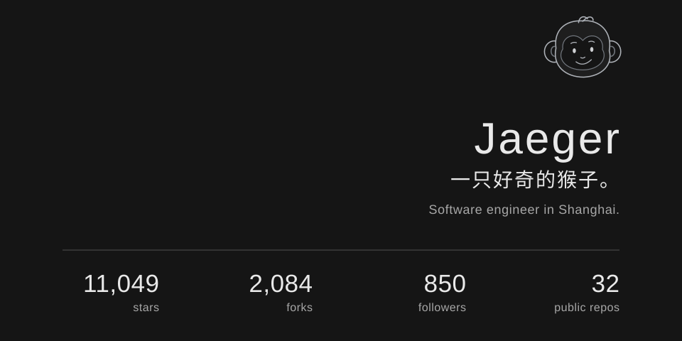

<!-- stats:start -->
<picture>
  <source media="(max-width: 600px)" srcset="assets/profile-dark-mobile.svg">
  
</picture>
<!-- stats:end -->

  <a href="https://jaeger.itscoder.com/blog/">Blog ↗</a>
  &nbsp;&nbsp; / &nbsp;&nbsp;
  <a href="https://x.com/imhouzi">X ↗</a>

